# agent-vessel

## About
**agent-vessel** is a deterministic test environment for AI agents built on a Zero-Trust architecture. Traditional evaluation methods trust summaries generated by the models themselves, making it easy to hide errors and leading to specification gaming. The project's vision is to completely decouple the agent's reasoning process from command execution. The agent only requests actions, while physical environment modification and rigorous outcome assessment are handled by an independent orchestrator. This provides more trust in the evaluation is based on hard facts rather than model hallucinations.

## How to run
Compile and install project:
```shell
cargo install --path vessel_cli
```
Run demo (this is default:
```shell

```

## Key Technological Highlights
+ **Rust & Typestate Pattern**: The type and ownership system enforces correct logic flow at compile time. The evaluator will not run until the system generates a secure, cryptographic proof of the introduced changes.
+ **Tool-call Filtering (ToolProxy)**: A direct firewall analyzing the semantics of agent requests. It instantly blocks destructive commands, protecting the system from malicious code execution.
+ **Hard Sandboxing (Docker API)**: Execution takes place in disposable containers with strict Linux kernel resource limits. Disconnecting the network stack and capping RAM guarantees complete security and stability of the host machine.
+ **Hallucination Detection (SHA-256)**: Workspace state analysis via file hashing before and after agent execution. The system ignores the model's verbal declarations, basing its verdict solely on indisputable disk modifications.

## Control Flow
The diagram below illustrates the Out-of-Band Verification architecture. 
Notice that the agent never touches the system directly, and the evaluator assesses only hard evidence from the file system, ignoring model declarations entirely.

```mermaid
sequenceDiagram
    participant O as Orchestrator (Rust)
    participant M as Monitor (SHA-256)
    participant A as Agent (LLM)
    participant P as ToolProxy
    participant S as Sandbox (Docker)

    O->>M: 1. Initial workspace snapshot
    activate M
    M-->>O: Returns Initial Hashes
    deactivate M
    
    O->>S: 2. Isolation (Net: None)
    
    rect rgb(30, 30, 40)
        note right of O: ReAct Loop
        loop Until goal is met
            O->>A: Provide goal and observation
            A-->>O: Returns intent (JSON)
            
            O->>P: Intent validation
            alt Attack attempt
                P-->>O: Denied (Rule violation)
                note left of O: Fail-Fast: Immediate loop termination
            else Legal command
                P->>S: Execute in sandbox (Docker Exec)
                S-->>P: Result (STDOUT/STDERR)
                P-->>O: Success (Log recorded)
            end
        end
    end
    
    O->>S: 3. Sandbox purge
    
    O->>M: 4. Final workspace snapshot
    activate M
    M-->>O: Returns Final Hashes
    deactivate M
    
    O->>O: 5. Changes calculation and final Evaluation
```



## Future Work
- **Model Context Protocol (MCP) Integration**: Migrating from hardcoded JSON tool endpoints to full MCP support.
- **Deterministic LLM-as-a-Judge**: Upgrading the Evaluator for complex tasks. Instead of relying solely on binary hash diffs, a secondary, isolated "Judge LLM" will score the execution of the agent. We keep Judge blind to the agent's self-reported summary.
- **eBPF Kernel-Level Telemetry**: Implementing eBPF (Extended Berkeley Packet Filter) probes to monitor system calls (syscalls) generated inside the Docker container. This will allow to catch tries of sandbox escape and risks that proxy could not cover.

### Tech
- Language: Rust (Async traits, Typestate pattern)
- Concurrency: Tokio, Reqwest (non-blocking I/O)
- Process Isolation: Docker Engine API (bollard)
- Verification: Cryptographic algorithms sha2 (SHA-256), static analysis walkdir
- Interface: Serde (JSON), Clap (CLI)